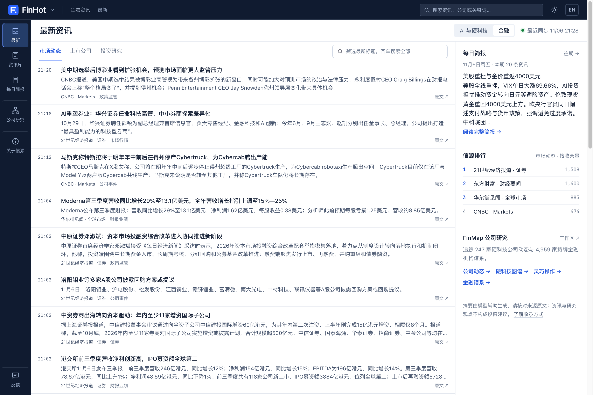
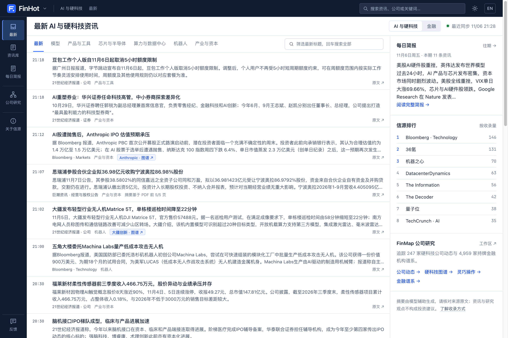
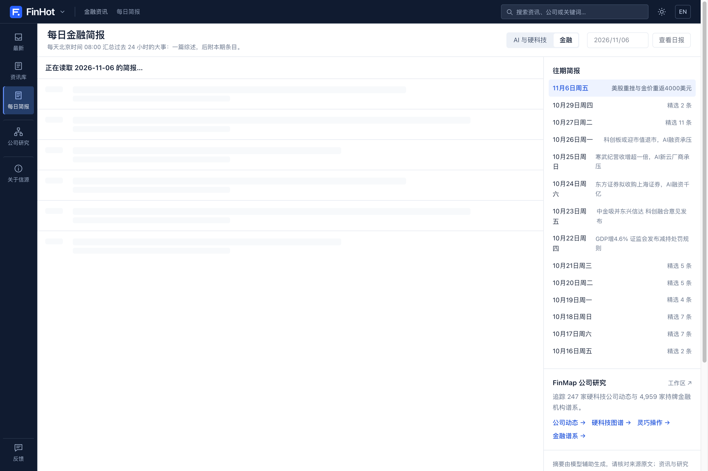

<div align="center">

# FinHot · 金融与 AI 硬科技实时情报终端

**自动盯盘 63+ 一手监管、交易所公告、卖方研报与全球 AI 信源：规则去噪 → 双次大模型独立打分 → 事件聚簇 → 每日 08:00 简报。**

[](https://finhot.fun)
[](https://map.finhot.fun)
[](LICENSE)
[](package.json)
[](docker-compose.yml)
[](docs/cloudflare.md)

<p align="center">
  <a href="https://finhot.fun"><b>立即访问线上终端 (finhot.fun) ↗</b></a> ·
  <a href="https://finhot.fun/?domain=ai">AI 与硬科技分站</a> ·
  <a href="https://finhot.fun/daily">每日 08:00 简报</a> ·
  <a href="https://map.finhot.fun">FinMap 产业与机构图谱 ↗</a> ·
  <a href="#3-分钟本地跑起来">快速部署</a> ·
  <a href="#如何改成你自己的行业站">定制指南</a>
</p>

</div>

<p align="center">
  <picture>
    <source media="(prefers-color-scheme: dark)" srcset="docs/assets/hero-dark.png">
    
  </picture>
</p>

<table width="100%">
  <tr>
    <td width="50%" align="center">
      <br>
      <sub><b>「AI 与硬科技」双域切换</b>：独立评分标准与技术分类（具身智能 / 世界模型 / 算力芯片）</sub>
    </td>
    <td width="50%" align="center">
      <br>
      <sub><b>每日 08:00 自动成刊</b>：按板块提炼核心导语、关键数字与一手原文出处</sub>
    </td>
  </tr>
</table>

---

## 为什么做 FinHot

金融与硬科技信息的问题从来不是太少，而是**太散、太吵、套话太多**：
交易所每晚几百条「独立董事候选人声明」「修订公司章程」「H 股翌日披露报表」，券商每天几十篇只改个标题的「晨会纪要」，财经快讯把同一条消息翻来覆去推送几十遍——真正改变行业规则、宏观预期或公司基本面的几条关键信息反而被淹没了。

**FinHot 是一个替你先读一遍、筛掉噪音的专业投研编辑台（与 [FinMap 硬科技产业链与金融机构图谱](https://map.finhot.fun) 组成完整投研套件）：**

1. **一手信源优先（63+ 核心源）**：直连中国证监会、人民银行、国家统计局、上交所、深交所、巨潮资讯、美联储、欧洲央行、国际清算银行（BIS）、东方财富研报、华尔街见闻、CNBC 及全球头部 AI 实验室官方博客。
2. **针对公告与研报的硬核规则预筛（[`industry/prescreen.ts`](industry/prescreen.ts)）**：在进大模型前，先用精细规则把「独董提名声明」「章程修订」「股东大会法律意见书」「无增量晨会纪要」等程序性噪音直接拦截，既省 Token 又保证信息流纯粹。
3. **双次独立大模型打分 + 零幻觉中文摘要（[`industry/prompts/`](industry/prompts/)）**：所有评分标准与写作 Prompt 100% 开源。会改变规则、数据或公司基本面的消息排在最前；严格区分“已发生事实”与“机构预测”，绝不把原文未提及的股票或公司塞进标题。
4. **跨信源事件聚簇与真实热度排序**：同一件事被十家媒体转发只合并成 1 个事件，按 48 小时内独立来源数量计算热度。
5. **金融 × AI 硬科技双领域引擎**：内置「金融市场（11 大分类）」与「AI 与硬科技（大模型、算力芯片、具身智能与机器人等）」双领域，各自拥有独立的评分 Prompt、入选门槛与每日简报。

---

## 它是怎么工作的

<p align="center">
  <picture>
    <source media="(prefers-color-scheme: dark)" srcset="docs/assets/how-dark.png">
    
  </picture>
</p>

### 1. 事件聚簇与独立信源热度

<p align="center">
  <picture>
    <source media="(prefers-color-scheme: dark)" srcset="docs/assets/cluster-dark.png">
    
  </picture>
</p>

先用标题与摘要向量在近两周内容池中召回候选，再由大模型判断属于“同一事件”“后续进展”还是“不同事件”；热度在 48 小时窗口内按**独立信源数**计算（同一媒体连发十篇只记一次，24 小时半衰期衰减）。

### 2. 前后台分离架构：后台重计算 + Cloudflare 边缘毫秒级响应

```text
63+ 一手信源 ──► 采集与处理服务器（正文/PDF 提取 · 规则去噪 · 双次模型评分 · 事件聚合 · 日报生成 · PostgreSQL）
                                │ 每 2 分钟增量同步已审公开结果
                                ▼
               Cloudflare Workers + D1（全球边缘缓存页面、全文检索、RSS、API、MCP）──► 读者与 AI Agent
```

- **前台零回源、零模型开销**：访客访问 [finhot.fun](https://finhot.fun) 时 100% 由 Cloudflare Workers + D1 响应，不触碰后端数据库，也不触发任何大模型调用。
- **双重预算熔断**：支持按每小时调用次数与滚动 24 小时金额设置硬上限，超额自动熔断保护账单。
- **原生支持 AI Agent 接入**：内置分类 RSS、REST API、MCP Server 与 `/llms.txt`。

---

## 核心模块一览

| 模块 | 能力说明 | 关键代码路径 |
|---|---|---|
| **多源采集与 PDF 提取** | 支持 RSS、网页列表、JSON 接口、PDF 公告/研报正文解析，按信源产出动态调整抓取频率 | [`packages/backend/src/sources/`](packages/backend/src/sources/) · [`pdf.ts`](packages/backend/src/content/pdf.ts) |
| **公告与研报预筛去噪** | 精准识别并剔除人事程序性文件、章程修订、例行挂牌披露与低价值快讯 | [`industry/prescreen.ts`](industry/prescreen.ts) |
| **双领域评分与写作 Prompt** | 金融与 AI 硬科技各自独立的评分体系、反幻觉规则、答案先行摘要与中英双语生成 | [`industry/prompts/`](industry/prompts/) · [`industry/domains.ts`](industry/domains.ts) |
| **事件聚簇与每日简报** | 自动合并同事件多方报道，每日 08:00 生成分板块结构化晨报 | [`packages/backend/src/events/`](packages/backend/src/events/) · [`reports/`](packages/backend/src/reports/) |
| **Cloudflare 边缘前台** | 极速终端 UI（支持快捷键 `/` 搜索、抽屉速览、深浅色同步、中英切换） | [`deploy/free/`](deploy/free/) · [`docs/cloudflare.md`](docs/cloudflare.md) |

---

## 3 分钟本地跑起来

需要 [Docker](https://docs.docker.com/get-docker/) 和任意一个 OpenAI 兼容的模型 API Key（DeepSeek、通义千问、智谱 GLM 等均可）：

```bash
git clone https://github.com/Jrdgr-FE/finhot.git
cd finhot
node scripts/init-env.ts --llm-key <你的模型 API Key>
docker compose up -d --build
```

- 前台地址：<http://localhost:3000>
- 管理后台：<http://localhost:3000/admin>（管理员密码自动生成在 `.env` 的 `ADMIN_PASSWORD` 中）
- 如果想和 `finhot.fun` 一样使用 **服务器采集 + Cloudflare Workers/D1 前台** 架构，请按 [《用 Cloudflare 做前台》](docs/cloudflare.md) 三步配置。

---

## 如何改成你自己的行业站

你可以直接把本仓库交给 Claude Code / Codex / Cursor，输入一句指令即可改造成任意垂直行业（如生物医药、法律合规、新能源、出海电商）的情报站：

```text
请阅读 AGENTS.md 和 docs/customize.md，把这个仓库改造成「生物医药」行业的每日情报站。
我重点关注的信源与选稿标准是：……
```

所有行业配置都集中在 [`industry/`](industry/) 目录下，无需修改底层流水线代码：

| 文件 | 定制内容 |
|---|---|
| [`industry/sources.json`](industry/sources.json) | 初始信源列表与分级 |
| [`industry/taxonomy.ts`](industry/taxonomy.ts) / [`domains.ts`](industry/domains.ts) | 行业分类体系、实体别名词典与多领域开关 |
| [`industry/prompts/`](industry/prompts/) | **核心 KnowHow**：评分标准（`selection-score.md`）与摘要写作规范 |
| [`industry/prescreen.ts`](industry/prescreen.ts) / [`selection.ts`](industry/selection.ts) | 预筛黑名单规则与入选分数门槛 |
| [`industry/site.ts`](industry/site.ts) | 站点名称、Slogan 与导航文案 |

更多文档：[定制指南](docs/customize.md) · [信源配置](docs/sources.md) · [精选与校准](docs/selection.md) · [服务器部署](docs/deploy.md) · [Cloudflare 边缘前台](docs/cloudflare.md) · [系统架构](docs/architecture.md)

---

## 致谢与许可

- 本项目基于 [AIHOT](https://github.com/KKKKhazix/AIHOT)（作者：数字生命卡兹克，MIT License）开源框架深度定制与扩展，感谢原作者开源的基础流水线与聚簇设计。
- 代码采用 [MIT 许可证](LICENSE) 开源。自行部署时请替换为您自己的站点名称与品牌标识。

---

## English Overview

**FinHot** ([finhot.fun](https://finhot.fun)) is an open-source **Financial & AI Hardtech Intelligence Terminal** paired with [**FinMap**](https://map.finhot.fun) (247-company hardtech supply-chain & 4,959-institution financial lineage workbench).

- **63+ Primary & Industry Sources**: Tracks CSRC, PBOC, NBS, SSE/SZSE/CNINFO filings, Fed, ECB, BIS, broker research, and global AI/robotics feeds.
- **High-Signal Rule Prescreening + Dual LLM Scoring**: Deterministically strips procedural filing noise (independent director declarations, bylaw amendments, boilerplate morning notes) before scoring every item twice with domain-specific prompts (`Finance` & `AI / Hardtech`).
- **Event Clustering & 08:00 Daily Briefing**: Groups multi-source articles into single events, ranks hot stories by unique independent sources, and publishes a structured daily briefing every morning.
- **Hybrid Edge Architecture**: Heavy extraction, PDF parsing, and LLM pipelines run on your server with strict hourly/daily cost circuit breakers, while public traffic is served globally from **Cloudflare Workers + D1** in <10ms.
